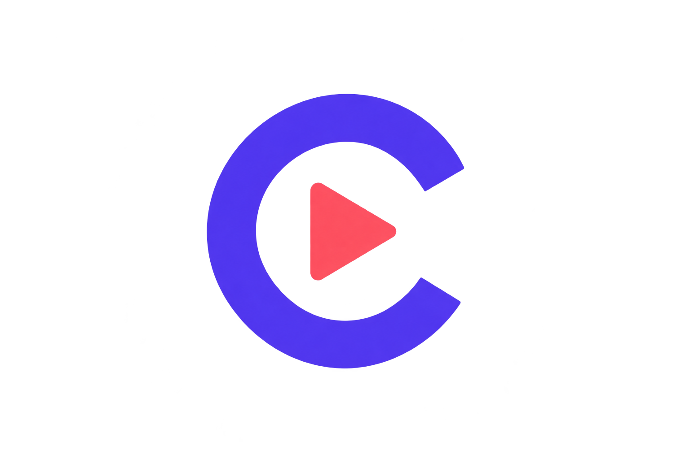

<p align="center"></p>

# Clip Clip (escritorio, Windows)

> Antes se llamaba **ClipsVirales**. Al actualizar, tus datos se trasladan solos (ver «Migración desde ClipsVirales»).

Aplicación de escritorio que, a partir de la URL de un vídeo **que tengas derecho a usar**, genera de 1 a 20 clips verticales 9:16 con subtítulos para TikTok, Reels y YouTube Shorts. **Todo se ejecuta en tu equipo**: descarga, transcripción, IA, render, historial y logs. Sin nube, sin APIs de pago y sin bases de datos remotas.

## Requisitos

| Dependencia | Para qué | Instalación recomendada (PowerShell) |
|---|---|---|
| Windows 10/11 x64 | — | — |
| [Ollama](https://ollama.com/download/windows) | Análisis con IA local | Instalador oficial |
| FFmpeg + FFprobe | Audio, metadatos y render | `winget install Gyan.FFmpeg.Essentials` |
| yt-dlp | Descarga | `winget install yt-dlp.yt-dlp` |
| Whisper (openai-whisper) | Transcripción local con marcas por palabra | Python 3.10+ y `pip install -U openai-whisper` |

En el primer inicio la app abre **Configuración → Diagnóstico**, comprueba cada dependencia (Ollama instalado, servicio, modelo, ffmpeg, ffprobe, yt-dlp y Whisper) y muestra instrucciones si falta algo. Las rutas de los ejecutables se pueden indicar manualmente.

### Modelos
- **Perfiles de IA** (Configuración → Modelo de IA): *Rápido* `qwen2.5:3b` (≈ 1,9 GB), *Equilibrado* `qwen2.5:7b` (≈ 4,7 GB), *Calidad* `llama3.1:8b` (≈ 4,9 GB) y *Personalizado*. Cada perfil muestra descarga, memoria, calidad, velocidad y si cabe en tu GPU. Se recomienda *Equilibrado* sólo si cabe entero en la VRAM; con 6 GB se recomienda *Rápido* (7B y 8B irían parcialmente en CPU/RAM). Un modelo mayor puede mejorar la selección y el formato, pero usa más memoria y puede tardar más.
- **Benchmark local opcional** («Probar velocidad»): prompt corto estructurado; muestra tokens/s, carga y dónde quedó el modelo (`/api/ps`: 100 % GPU, parcial o CPU). No se ejecuta mientras haya un trabajo en curso. Medido aquí: `llama3.2:3b` 81,4 tokens/s, 100 % en GPU (GTX 1660 SUPER).
- Las descargas de modelos de Ollama piden confirmación con el tamaño y se pueden **cancelar** (Ollama conserva lo descargado y reanuda).
- **Ollama**: se elige y descarga desde Configuración (tamaño aproximado indicado: `llama3.2:3b` ≈ 2 GB, `gemma3:4b` ≈ 3,3 GB, `qwen2.5:7b` ≈ 4,7 GB, `llama3.1:8b` ≈ 4,9 GB) o cualquier modelo ya instalado. No está codificado: es un ajuste.
- **Whisper**: `tiny` (75 MB), `base` (145 MB), `small` (465 MB), `medium` (1,5 GB), `large` (2,9 GB), `turbo` (1,6 GB). Recomendado: en CPU `base` (equilibrio) o `small` (más preciso); con GPU CUDA `turbo`. **Nunca se descarga sin tu confirmación**: si el modelo no está en caché, Inicio muestra la casilla «Permitir descargar el modelo» con su tamaño. Caché: `%USERPROFILE%\.cache\whisper` (openai-whisper) y `%USERPROFILE%\.cache\huggingface\hub` (faster-whisper).
- Ningún modelo se incluye en el instalador.

## Uso
1. **Inicio**: pega la URL y pulsa **Comprobar vídeo** (obligatorio). Se muestran por separado la **duración del vídeo fuente** (p. ej. «98 min 1 s») y la **duración de cada clip**, el máximo posible de clips, el espacio en disco y el tiempo de transcripción aproximados. Los vídeos de más de 20 minutos requieren una confirmación explícita. Elige la duración de cada clip (15/30/45/60 s) y una **meta de clips** explícita: Rápido (5), Estándar (10), Máximo (hasta 20) o un valor 1–20. La app calcula el máximo sin solapes (`floor(duración / preset)`, tope 20) y la **meta efectiva** = mín(meta, 20, máximo). Confirma que tienes derechos y pulsa **Iniciar**.
2. **Trabajos**: activos y terminados separados con filtros (Activos · Completados · Fallidos · Cancelados) y contadores. Cada trabajo en curso muestra una línea de etapas (validando, obteniendo metadata, descargando, extrayendo audio, descargando/cargando modelo, transcribiendo, analizando, seleccionando, renderizando, listo para exportar) con tiempo por etapa, porcentaje, ETA cuando hay muestra suficiente, CPU/GPU, «clip 7 de 20» durante el render, cancelación con confirmación y detalle técnico desplegable. Los terminados muestran miniatura, título, duración del vídeo, fecha, `clips generados/meta`, tiempo total y estado, con acciones Abrir resultados · Abrir carpeta · Reintentar (crea un trabajo nuevo con la misma URL, duración y meta) · Eliminar, la causa del fallo en lenguaje simple con «Ver diagnóstico» y el informe completo desplegable.
3. **Resultados**: previsualización, título editable, hook, timestamps, duración, **Exportar**, **Exportar todos**, **Abrir carpeta**, y el resultado honesto `obtenidos/meta`.

### «Hasta 20 clips», nunca «20 garantizados»
- 20 clips de 30 s requieren al menos 600 s de vídeo; uno de 421,86 s admite como máximo 14 de 30 s.
- La IA recibe la meta exacta («genera exactamente N»). Si devuelve menos válidos, se hacen hasta 3 rondas de relleno que sólo piden los que faltan, enviando los intervalos ya elegidos y sólo los tramos libres de la transcripción.
- Cada candidato se valida: timestamps posibles, duración del preset, sin solapes, título/razón útiles (se descartan textos de plantilla como «¿Por qué funciona?»), voz suficiente. Un hook vacío o copiado del título se sustituye por la frase real con la que empieza el clip. La puntuación final combina una **puntuación local determinista** (densidad de habla, frases completas, énfasis, coincidencia del hook con lo dicho) con el score del modelo (si es válido).
- Si no se alcanza la meta, el trabajo termina con, p. ej., `3/5 clips generados: no se encontraron más momentos distintos que cumplan los criterios`; nunca con un «Listo» genérico.

La app no publica en redes sociales.

## Plantillas verticales: gameplay + facecam (experimental)

Tres etapas, todo local:
1. **Selección textual**: transcripción + Ollama eligen los clips.
2. **Análisis visual ligero sólo de los clips elegidos**: 6 fotogramas en gris a 160×90 por clip (una llamada a FFmpeg por clip; nunca se analiza el vídeo entero). El motor por defecto (`marco-fijo-v1`, sin dependencias) busca el **marco rectangular de una facecam superpuesta**: bordes rectos que se mantienen fijos en todos los fotogramas mientras el gameplay cambia. Clasifica: sin facecam, facecam arriba/abajo/izquierda/derecha, cámara a pantalla completa o incierto. No reconoce caras; la interfaz `VisualAnalyzer` permite añadir después un detector de caras (p. ej. OpenCV) o un VLM opcional sobre esos mismos fotogramas.
3. **Render** con la plantilla de cada clip (`LayoutStrategy`, `src/main/layoutRender.ts`):

| Plantilla | Resultado |
|---|---|
| Gameplay completo | Recorte vertical actual |
| Gameplay arriba + facecam abajo | 1080×1216 de gameplay + 1080×704 de cámara |
| Facecam arriba + gameplay abajo | Lo mismo, invertido |
| Gameplay vertical + facecam flotante | Recorte vertical con la cámara superpuesta arriba a la derecha |
| Sin facecam | Vídeo entero sobre fondo difuminado (no se recorta nada) |

**Seguridad del resultado**: en «Auto» sólo se aplica una plantilla con facecam si la confianza es ≥ 60 % y hay rectángulo; si no, se usa «Gameplay completo» y el clip muestra la sugerencia. Ninguna plantilla inventa la posición de la cámara.

**Resultados → Editar clip**: cambiar título, hook, inicio/fin (validado: dentro del vídeo, duración del preset y sin solapes), plantilla y recuadro de la facecam sobre el fotograma real (deslizadores accesibles por teclado), **Vista previa** (un fotograma con la plantilla) y **Guardar y volver a renderizar** sólo ese clip. Los clips con cambios sin renderizar no se exportan y el contador muestra `N/N clips listos`. El re-render necesita el vídeo original: si activas «Borrar el vídeo original al completar», no estará disponible.

## Editor de clip, subtítulos y directos
- **Editar clip** (modal) tiene tres pestañas:
  - **Composición:** 8 plantillas, caja de cámara arrastrable y redimensionable, zoom y encuadre, posición, formato 9:16, 1:1 o 16:9, guías de área segura, vista previa rápida y «Restablecer detección automática».
  - **Subtítulos:** cues editables con tiempos, dividir y unir, reproducir desde un cue y restablecer.
  - **Título y tramo.**
  - Renderizar un clip no vuelve a descargar ni a transcribir. Ver [ADR 0002](docs/adr/0002-composicion-no-destructiva.md).
- **Subtítulos por palabra:** cues de 2–5 palabras que respetan el tiempo de cada palabra. El idioma se fuerza en Whisper (español por defecto) y «Detectar automáticamente» es una opción explícita. **Reprocesar sólo transcripción** está en Resultados. Ver [ADR 0004](docs/adr/0004-subtitulos-por-palabra.md).
- **Progreso con tarjetas:** 9 pasos con estado, porcentaje, tiempo, ETA y datos concretos. **Ver detalles** abre los logs técnicos, y **Reintentar desde este paso** reutiliza el vídeo, el audio y la transcripción ya producidos.
- **Directos:** vigila un directo de YouTube propio o autorizado y genera clips por bloques con solape, deduplicados. Se puede pausar, reanudar y detener, y se reanuda tras cerrar la app. No hay DVR: los huecos se muestran. Ver [ADR 0003](docs/adr/0003-monitor-de-directos.md).
- Guía de pruebas con vídeo normal, gameplay con facecam y directo: [docs/pruebas-manuales.md](docs/pruebas-manuales.md).

## Aceleración por GPU (NVIDIA CUDA)

**«GPU NVIDIA detectada» no es lo mismo que «CUDA habilitado»**. La app comprueba ambas cosas por separado en Configuración → *GPU y motor de transcripción*:

| Dato | Cómo se obtiene |
|---|---|
| GPU NVIDIA, VRAM, driver | `nvidia-smi` |
| Python / Torch / versión CUDA de Torch | `resources/python/probe.py` (ejecutado sin argumentos de usuario) |
| CUDA realmente usable por Whisper | `torch.cuda.is_available()`; un Torch `+cpu` nunca cuenta como GPU |
| CUDA en faster-whisper | `ctranslate2.get_cuda_device_count()` y tipos de cómputo `float16` |

**Motores** (selección automática del mejor disponible, o fijo en Configuración):
1. `faster-whisper · GPU` (CTranslate2): el más rápido y con menos VRAM; `float16`, o `int8_float16` si la VRAM va justa.
2. `openai-whisper · GPU`: `--device cuda` con FP16 (sin `--fp16 False`); opción FP32 para GPUs con problemas de FP16.
3. `openai-whisper · CPU`: siempre `--fp16 False`.

Si el modelo elegido no cabe en la VRAM con un margen del 5 % (aprox.: openai-whisper turbo ≈ 6 GB, medium ≈ 5 GB, large ≈ 10 GB) se usa uno menor con aviso; con 6 GB, por ejemplo, se usa `medium`.

**GTX 16xx (p. ej. GTX 1660 SUPER, GTX 1650):** Whisper en FP16 produce `NaN` en estas GPUs (verificado: el CLI imprime «Skipping … due to ValueError … invalid values» y sale con código 0 sin escribir la transcripción). En precisión «Automática» la app usa **FP32 en GPU** en esta serie; en otras GPUs usa FP16 y, si falla, reintenta en FP32 antes de bajar de modelo o pasar a CPU. Medido en GTX 1660 SUPER: `medium` FP32 transcribió 120 s de audio en ≈ 72 s incluyendo la carga del modelo.

**Validación de la salida:** un código de salida 0 no basta. Tras cada intento se busca el JSON generado (nombre esperado u otro `.json` nuevo en la carpeta del trabajo) y se valida que sea parseable, con segmentos, timestamps y texto. Si no, el trabajo falla con «Whisper terminó sin generar un JSON válido; abre Configuración → Diagnóstico» y cada intento queda en *Última ejecución* y en `logs/events.jsonl` (`transcribe_attempt`: motor, modelo, dispositivo, precisión, argumentos sin rutas, código de salida, últimas líneas de stdout/stderr, archivo esperado y archivos presentes). Si la GPU falla durante la transcripción (falta de memoria, cuDNN…) se reintenta con un modelo menor en GPU y después en CPU, siempre con modelos ya descargados o con tu permiso. Antes de transcribir en GPU se pide a Ollama que libere su modelo de la VRAM (`keep_alive: 0`).

### Activar aceleración GPU desde la app (recomendado)
Configuración → **Aceleración** muestra un estado claro: *GPU lista (verificada)*, *CUDA detectado, sin verificar*, *Disponible para instalar*, *Instalando…*, *Error* o *No disponible*.

- **Activar aceleración GPU** abre una confirmación con qué se instala (PyTorch CUDA 12.6 + openai-whisper), el origen oficial (`download.pytorch.org/whl/cu126` y PyPI), el tamaño (≈ 2,8 GB), el espacio libre necesario (6 GB) y dónde: un **entorno virtual aislado dentro de la carpeta de datos de la app** (`%APPDATA%\Clip Clip\python-env`). Tu Python del sistema no se modifica.
- Pasos con progreso real (`pip --progress-bar raw`) y registro técnico desplegable (`logs/gpu-setup.log`, sin rutas de usuario): crear entorno → instalar PyTorch CUDA → instalar Whisper → comprobar CUDA → **transcripción de prueba en GPU** (audio generado con las voces de Windows y modelo `tiny`).
- **La GPU sólo se marca como lista si esa transcripción real produce un JSON válido**, no basta con que Torch diga `cuda=True`.
- Se puede **cancelar** y **reintentar** (pip reaprovecha lo descargado). Errores con acción concreta (conexión, espacio, versión de Python sin ruedas, permisos).
- **Verificar GPU ahora** hace sólo la comprobación y la prueba real con el Python actual, sin instalar nada.
- **Usar CPU** / **Usar GPU** cambian el motor sin romper la app; **Usar el Python del sistema** deja de usar el entorno de la app.
- Requisitos: GPU NVIDIA con driver, Python 3.11–3.14 de 64 bits (versiones con ruedas `torch+cu126` comprobadas en el índice oficial). Si no hay Python compatible, se enlaza la descarga oficial de python.org.

### Habilitar CUDA en Windows (pasos manuales)
La app **no instala nada automáticamente**; muestra estos comandos con un botón «Copiar comandos». Con el Python del entorno de Whisper (PowerShell):

```bash
& "$env:LOCALAPPDATA\Programs\Python\Python314\python.exe" -m pip uninstall -y torch
```

```bash
& "$env:LOCALAPPDATA\Programs\Python\Python314\python.exe" -m pip install torch --index-url https://download.pytorch.org/whl/cu126
```

- Verificado en el índice oficial de PyTorch (2026-11-18): hay ruedas `torch 2.14.1+cu126` para **Python 3.14** en Windows x64. CUDA 12.6 es compatible con GPUs Turing como la GTX 1660 SUPER y con drivers recientes. Descarga ≈ 2,5 GB.
- Opcional, faster-whisper: `pip install -U faster-whisper` (ruedas de CTranslate2 4.9 para cp314). Según su documentación oficial, en GPU necesita **cuBLAS para CUDA 12 y cuDNN 9**; en Windows su instalación por pip sólo está documentada para Linux. La app intenta reutilizar las DLL que trae Torch CUDA; si CTranslate2 no detecta CUDA, se queda con openai-whisper en GPU.
- Después pulsa **Volver a comprobar**: «CUDA habilitado para Whisper» debe decir **sí** y «Motor activo» debe mostrar **GPU**.

### Cómo comprobar que se usa la GPU
- Inicio muestra `Transcripción: GPU · …` (en verde) o `CPU` (en ámbar).
- Durante la transcripción, el mensaje empieza por `[GPU]` o `[CPU]` y muestra % · audio procesado · tiempo transcurrido · velocidad (`2.5× tiempo real`) · tiempo restante (sólo cuando hay muestra suficiente). Se distingue «Descargando modelo» de «Iniciando modelo» y de la transcripción.
- Configuración → **Última ejecución**: tiempo por fase, render por clip, total, motor, modelo y velocidad.
- `nvidia-smi` en otra terminal debe mostrar un proceso `python.exe` usando memoria de la GPU.

### Tiempos orientativos (no son garantías)
Medido en este equipo (CPU de escritorio, sin CUDA): un audio de 630 s con `tiny` en CPU tardó 382 s (≈ 1,6× tiempo real); `small` en CPU es varias veces más lento (≈ 11 min para 7 min de vídeo). En GPU CUDA, openai-whisper y faster-whisper suelen ir muchas veces más rápido que en CPU, según el modelo y la tarjeta. El análisis con Ollama `llama3.2` (3B) tardó ≈ 12 s para 5 clips.

## Desarrollo

```bash
npm install
```

```bash
npm run dev
```

| Comando | Qué hace |
|---|---|
| `npm run dev` | Compila main/preload, arranca Vite (127.0.0.1:5183) y abre Electron |
| `npm test` | Pruebas unitarias e integración (la de FFmpeg se omite si no está instalado) |
| `OLLAMA_TEST_MODEL=llama3.2:latest npm test` | Incluye la prueba real con Ollama |
| `npm run typecheck` | TypeScript estricto en renderer y main |
| `npm run build` | Typecheck + build de producción en `dist/` y `dist-electron/` |
| `npm run package` | Genera el instalador `release/Clip-Clip-Setup-<versión>.exe` (NSIS) |
| `npm run package:dir` | App desempaquetada en `release/win-unpacked` (prueba rápida) |
| `npm run clean:release` | Limpia instaladores antiguos de `release/` (sólo desarrollo; simulación salvo `--yes`) |

> npm ≥ 11 bloquea scripts de instalación: `package.json` aprueba explícitamente `electron` y `electron-winstaller` (`allowScripts`). Si el binario de Electron no aparece, ejecuta `node node_modules/electron/install.js`.

### Empaquetar FFmpeg / yt-dlp (opcional)
Copia `ffmpeg.exe`, `ffprobe.exe` y/o `yt-dlp.exe` en `resources/bin/` antes de `npm run package`; se incluyen en `resources\bin` del instalador y tienen prioridad sobre el PATH. Revisa [THIRD_PARTY_NOTICES.md](THIRD_PARTY_NOTICES.md): las builds habituales de FFmpeg son GPL. Esos binarios están en `.gitignore`.

## Arquitectura

```
src/
  shared/     tipos, constantes (MAX_CLIPS=20) y validación pura (URL, presets, normalización de candidatos)
  main/       proceso principal (Node): IPC validado con zod, cola, pipeline, almacenamiento, procesos externos
    main.ts         ventana segura, protocolo clip:// para previsualizar, instancia única
    ipc.ts          handlers; valida origen del emisor y cada payload; errores amigables
    ipcSchemas.ts   esquemas zod estrictos
    queue.ts        cola FIFO con concurrencia 1–2 y cancelación por AbortController
    pipeline.ts     validar → descargar → audio → Whisper → Ollama → normalizar → render
    proc.ts         spawn con shell:false, timeouts y kill del árbol de procesos (taskkill /T)
    deps.ts         detección y diagnóstico de dependencias con ayuda accionable
    media.ts        ASS (escapado), CropStrategy (crop central; preparado para smart crop), args FFmpeg
    ollama.ts       cliente HTTP local (sólo 127.0.0.1/localhost)
    store.ts        JSON con escritura atómica (ajustes, trabajos)
  preload/    API mínima `window.clipsApi` vía contextBridge (sandbox)
  renderer/   React + Vite, sin Node; páginas Inicio, Trabajos, Resultados, Configuración, Uso responsable
tests/        Vitest
docs/         especificación de producto y revisión de seguridad
```

Decisiones clave: Electron + React + TypeScript + Vite; renderer con `contextIsolation`, `sandbox`, sin `nodeIntegration` y CSP estricta en producción; el main compila con `tsc` (CommonJS) y el renderer con Vite. Detalle en [docs/product-capability.md](docs/product-capability.md) y [docs/security.md](docs/security.md).

## Almacenamiento local

Todo vive en `app.getPath('userData')` = `%APPDATA%\Clip Clip`:

| Ruta | Contenido |
|---|---|
| `data\settings.json` | Preferencias |
| `data\jobs.json` | Historial y estado de trabajos |
| `jobs\<id>\source.mp4` | Vídeo original descargado |
| `jobs\<id>\audio.wav` | Audio temporal para la transcripción |
| `jobs\<id>\frames\` | Fotogramas de análisis visual y vistas previas |
| `jobs\<id>\clips\*.ass` | Subtítulos temporales del render |
| `jobs\<id>\transcript.json` | Transcripción con marcas por palabra |
| `jobs\<id>\clips\*.mp4` | Clips internos renderizados |
| `logs\app.log` | Logs técnicos (rotan a 5 MB; tokens/cookies redactados) |
| `logs\events.jsonl` | Eventos estructurados por trabajo (sólo dominio de la URL, métricas, rondas de análisis) |

Los clips exportados se copian (sin sobrescribir) a la carpeta de exportación, por defecto `Vídeos\Clip Clip` (si vienes de ClipsVirales se mantiene tu carpeta anterior). Borrar un trabajo pide confirmación y nunca toca los clips exportados. Desinstalar no borra los datos.

### Liberar espacio

**Trabajos → Liberar espacio** analiza el uso por categoría y muestra cuánto se puede recuperar antes de confirmar («Se liberarán X. Tus clips exportados se conservarán.»).

- **Se puede borrar** (de trabajos completados, fallidos o cancelados): vídeo original, audio WAV, fotogramas, subtítulos/temporales y, opcionalmente, la transcripción.
- **Clips internos**: sólo si tienen un export verificado (existe, tamaño > 0, igual al interno y fuera de la carpeta de trabajos). El clip queda «archivado» y Resultados reproduce el export.
- **Nunca se borra**: clips exportados, trabajos en curso ni nada fuera de `jobs\<id>`.
- Los archivos van a la **Papelera de reciclaje**; si alguno no puede, se pide una confirmación reforzada antes de borrarlo definitivamente. Los errores no detienen la limpieza y se resumen al final; todo queda en `logs\events.jsonl` (`storage_cleanup`).
- Cada tarjeta de trabajo tiene **Limpiar temporales** (sólo audio, fotogramas y subtítulos).

**Configuración → Almacenamiento**: conservar originales (siempre / hasta exportar / borrar tras confirmación), temporales (siempre / tras completar / tras exportar), conservar transcripción y limpieza automática tras X días (desactivada por defecto). Hay aviso de poco espacio según el mínimo de disco configurado. Los ajustes antiguos se migran sin borrar nada.

## Reglas de negocio implementadas
- Máximo absoluto de 20 clips en UI (slider), IPC (zod), prompt, parseo, normalización y comprobación final antes de render.
- Clips sin solapes, dentro de la duración real y con duración entre el 75 % del preset y preset + 1 s; los cortes se ajustan a límites de palabra.
- Si Ollama devuelve JSON inválido se reintenta una vez; se rescata JSON incrustado en texto; candidatos imposibles se descartan; si no queda ninguno, el trabajo falla con un mensaje claro.
- Límites configurables: duración máx. del vídeo, tamaño de descarga, espacio libre mínimo, trabajos simultáneos (1–2), cola máx. 10.
- Sólo contenido público: no se usan cookies ni credenciales y se rechazan directos y vídeos con `needs_auth`/`premium_only`/`subscriber_only`.

## Publicar (preparación local)

En **Resultados → Preparar publicación** se abre una ventana (modal) con los textos del clip para **TikTok, YouTube Shorts e Instagram Reels**. La página de fondo no se alarga: la ventana tiene cabecera y pie fijos, scroll interno, Escape para cerrar, foco atrapado y pantalla completa en ventanas estrechas. Si hay cambios sin guardar, cerrar pide confirmación.

- **Cabecera**: miniatura, título editable, duración y estado. **Cuerpo**: vista previa del clip a la izquierda; a la derecha tono, nicho, variantes de título, descripción (con contador), CTA opcional y hashtags como chips editables. **Pie**: Guardar borrador, Regenerar, Copiar título / descripción / hashtags y **Copiar publicación completa**.
- **Generar con IA** (Ollama local): 3 variantes de título con una razón breve, una descripción por plataforma, CTA opcional y 3–6 hashtags. Nada sale del equipo.
- **Estados** por plataforma (borrador, listo, programado, publicado, descartado). «Publicado» sólo se marca tras una confirmación nativa; nunca automáticamente. **Historial** de hasta 20 versiones con restaurar. Todo en `data\publish.json`.
- Los detalles técnicos (modelo, motivos de un rechazo, tramo) sólo están en la sección plegable **Diagnóstico**.

### Generador editorial: qué ve la IA
`src/shared/editorial.ts` construye un `EditorialContext` separado de los datos de render, análisis visual y almacenamiento. Sólo contiene: transcripción del clip, resumen y tema (del análisis), gancho, idioma, tono, nicho, entidades repetidas en la transcripción y etiquetas visuales semánticas con confianza suficiente (`gameplay`, `facecam`, `persona hablando`…).

**Nunca** recibe: URL, rutas, nombres de archivo (`source.mp4`, `clip_01`…), nombres de frame, IDs, timestamps, carpetas, logs ni metadata de render. Ni siquiera el título del vídeo de origen. Antes de enviarlo se pasa por `stripTechnical()`, y un campo del análisis que contenga texto técnico se descarta entero.

### Validación local (nunca se guarda basura)
Cada respuesta se valida antes de guardarse:
- **URL o ruta**: `http`, `www`, `.com`, `C:\`, `/jobs/`, `.mp4`, `.png`, `.jpg`…
- **Palabras técnicas**: imagen, URL, frame, archivo, `clip_`, source… (si las escribes tú a mano sólo se avisa).
- **Placeholders o genericidad**: «momento emotivo», «¿por qué funciona?», «sin título», «capítulo 1», `[TÍTULO]`…
- **Descripciones** que copian la transcripción literalmente, repiten el título, van entre comillas o superan la longitud recomendada (TikTok 220, Shorts 300, Reels 400; configurable en `DESCRIPTION_TARGET`).
- **Hashtags**: entre 3 y 6, sin repetir, sintaxis válida, sin #fyp/#foryou/#viral/#trending, relacionados con lo que se dice o se ve, y como mucho uno amplio de nicho o plataforma.

Si la respuesta falla, se **regenera una vez con los motivos concretos**. Si vuelve a fallar se quitan los hashtags inservibles; si aun así no es válida, **no se guarda nada** y el editor queda como estaba con el aviso «La IA necesita más contexto; edita manualmente». Sin contexto suficiente (transcripción casi vacía) no se llama a la IA.

Ejemplo con el fixture de `tests/editorial.test.ts` (clip de un taller con un Porsche; la prueba real con `llama3.2:3b` está en `tests/ollamaEditorial.integration.test.ts`):

| | Antes | Después (salida real de `llama3.2:3b`, ya validada) |
|---|---|---|
| Título | ¡La abuela de la imagen! | El Porsche más caro de mi vida |
| Descripción | «La abuela de la imagen» | ¿Qué pasa cuando un mecánico te cobra cinco mil dólares…? (Reels) |
| Hashtags | #Capitulo1 #GT6 #URLDeLaImagen #MomentoEmotivo | #porsche #mecanico |

La salida de un modelo de 3B puede exagerar un poco; por eso los textos siempre se revisan antes de publicar.

### Reglas de plataforma (recomendaciones, no garantías)
Están en `PLATFORM_GUIDES` (fáciles de actualizar) y se muestran en el modal y en **Conexiones**:
- **TikTok**: pocos hashtags relacionados con el contenido; no hace falta #FYP; texto corto con contexto.
- **YouTube Shorts**: título preciso y breve; hashtags relacionados; los metadatos engañosos o el exceso de hashtags se consideran spam.
- **Instagram Reels**: caption natural con contexto, CTA opcional y hashtags relevantes.

Ningún consejo promete alcance, viralidad ni resultados. No se consultan tendencias en línea.

**Conexiones**: hoy todo es manual. Hay una interfaz `PublisherAdapter` (`src/main/publishers.ts`) para futuras conexiones; no hay subida real, ni claves ni tokens en el repositorio. Si se añaden, las credenciales irían cifradas con el almacén seguro del sistema (Electron `safeStorage`) y cada subida pediría confirmación explícita por clip.

### Ventanas modales en toda la app
Las acciones secundarias se abren en una ventana (`src/renderer/components/Modal.tsx`), no despliegan contenido en la página: preparar publicación, editar clip (incluida la plantilla gameplay/facecam), elegir variante, confirmar exportación, Liberar espacio, limpiar temporales, cancelar trabajo, ver errores y diagnóstico, y eliminar exports publicados. Sólo se guarda al pulsar «Guardar» o «Aplicar».

### Exports ya publicados
- **Configuración → Almacenamiento → «Eliminar exports después de marcarlos como publicados»** (desactivado por defecto): al confirmar «publicado», el MP4 **exportado** de ese clip va a la Papelera de reciclaje (no sólo temporales).
- En un clip publicado: **«Eliminar export ya publicado»** muestra nombre, tamaño y ruta, y pide confirmación.
- **«Limpiar exports publicados…»** (lote): eliges plataformas, ves cuántos clips y cuánto espacio, y confirmas.
- Nunca se incluyen clips en borrador, listos, programados o sin publicar, ni archivos fuera de la carpeta de exportación. Siempre va a la Papelera; si falla, el archivo se conserva. El clip queda como «export eliminado tras publicación» y conserva título, textos, hashtags e historial. Cada paso se registra en `logs/events.jsonl`.

## Marca e iconos
- Logo oficial: `resources/brand/clip-clip-logo.png` (PNG con transparencia; no se modifica).
- `npm run icons` (también se ejecuta en `npm run build`) recorta un cuadrado centrado en el símbolo y lo escala, sin efectos: genera `build/icon.ico` (16, 24, 32, 48, 64, 128 y 256 px) para la app, el instalador, el desinstalador y los accesos directos, `build/icons/logo-*.png` para la ventana y `src/renderer/assets/logo-128.png` para la barra lateral y la pantalla de carga. Son archivos generados y no se versionan.

## Actualizaciones y migración desde ClipsVirales

### Actualizar Clip Clip
- El instalador mantiene fijos `appId: com.clipclip.desktop`, `productName`, `shortcutName` y `uninstallDisplayName` («Clip Clip»). Con el mismo `appId`, una versión nueva **sustituye** la instalación anterior en `%LOCALAPPDATA%\Programs\Clip Clip`: no se crean carpetas por versión. Si la app está abierta, el instalador pide cerrarla.
- **Se reemplaza automáticamente**: sólo los binarios de la instalación (`%LOCALAPPDATA%\Programs\Clip Clip`).
- **Se conserva siempre**: `%APPDATA%\Clip Clip` (ajustes, historial, trabajos, metadata de publicación y logs) y tus exports. Desinstalar tampoco los borra (`deleteAppDataOnUninstall: false`).
- La versión se ve en la barra lateral, en **Configuración → Acerca de**, en el nombre del instalador y en `logs/app.log` («Clip Clip X.Y.Z iniciado»).

### Datos de ClipsVirales (nombre anterior)
Windows trata «ClipsVirales» como otra aplicación, así que su instalación y sus datos quedan aparte. Al abrir Clip Clip, si encuentra `%APPDATA%\ClipsVirales` o `%LOCALAPPDATA%\Programs\ClipsVirales`, muestra **«Encontramos datos de ClipsVirales que ocupan X GB»** con tres opciones. **Nada se migra ni se borra sin elegir una**:
- **Migrar y conservar copia antigua**: traslada `data` (ajustes e historial), `jobs` y `logs` a `%APPDATA%\Clip Clip` sin sobrescribir nada existente (el historial se fusiona por trabajo; vídeos y audio se enlazan sin ocupar más disco). ClipsVirales no se toca.
- **Migrar y liberar espacio**: igual, luego **verifica** que todo está en Clip Clip y, sólo si la verificación pasa, envía la carpeta de datos y la instalación antiguas a la **Papelera de reciclaje** (no es un borrado irreversible). Muestra el resumen y el espacio liberado. Si Clip Clip usa algo de la carpeta antigua (p. ej. el Python con CUDA de `python-env`), esa parte se conserva.
- **Ignorar por ahora**: no vuelve a preguntar; se puede retomar en **Configuración → Almacenamiento → Datos de ClipsVirales**.

Los exports antiguos (`Vídeos\ClipsVirales`) sólo se muestran con su tamaño: no se migran ni se borran. Si la migración falla, se conservan ambas carpetas y no se envía nada a la Papelera. Todo queda en `logs/app.log` y `logs/events.jsonl`. Tras enviar la instalación antigua a la Papelera puede quedar una entrada «ClipsVirales» en Aplicaciones de Windows; se puede quitar desde ahí.

**Qué requiere confirmación**: migrar datos antiguos, enviar ClipsVirales a la Papelera, eliminar exports publicados y Liberar espacio. Sólo las rutas conocidas (`%APPDATA%\ClipsVirales`, `%LOCALAPPDATA%\Programs\ClipsVirales`) pueden ir a la Papelera, nunca la carpeta actual de datos, instalación o exportación.

### Builds locales (sólo desarrollo)
`release/` contiene artefactos de compilación (instaladores, `win-unpacked`), no datos de usuario. Para limpiarlos:

```bash
npm run clean:release            # simulación: muestra qué se borraría
npm run clean:release -- --yes   # borra lo antiguo y conserva el instalador de la versión actual
npm run clean:release -- --yes --all
```

Sólo actúa dentro de `<repo>/release`: no toca código fuente, `node_modules`, datos de usuario ni exports. No se ejecuta nunca automáticamente ni forma parte de la app instalada.

## Solución de problemas

| Síntoma | Solución |
|---|---|
| «Faltan dependencias» | Configuración → Diagnóstico muestra el comando exacto. Tras instalar, pulsa *Volver a comprobar* (reinicia si cambió el PATH). |
| «Servicio Ollama» en rojo | Abre Ollama desde el menú Inicio o ejecuta `ollama serve`. |
| Modelo no descargado | Descárgalo desde Configuración o elige uno de «Modelos ya instalados». |
| Whisper no encontrado aunque esté instalado | Indica la ruta, p. ej. `%LOCALAPPDATA%\Programs\Python\Python3xx\Scripts\whisper.exe`. |
| La transcripción es muy lenta | Mira el indicador CPU/GPU. Si dice CPU y tienes NVIDIA, sigue «Habilitar CUDA en Windows». En CPU usa `base`. |
| «GPU NVIDIA detectada» pero «CUDA habilitado: no» | Torch es la versión `+cpu`: reinstálalo desde el índice `cu126` (ver arriba). |
| Falta de memoria en GPU | La app reintenta con un modelo menor y luego en CPU. Prueba `turbo` con faster-whisper o `small` con openai-whisper; cierra otras apps que usen la GPU. |
| Resultados raros con FP16 (texto vacío o repetido) o «Whisper terminó sin generar un JSON válido» | En GTX 16xx ya se usa FP32 automáticamente; en otras GPUs, Configuración → Precisión en GPU → FP32. Revisa *Última ejecución* para ver el motivo de cada intento. |
| «El modelo … no está descargado» | Marca «Permitir descargar el modelo» en Inicio o elige un modelo ya descargado. |
| Menos clips que la meta | El resultado indica `obtenidos/meta` y el motivo; Configuración → Última ejecución muestra rondas y descartes. Prueba un modelo de Ollama mayor. |
| La descarga falla | El vídeo puede ser privado, con restricción de edad o geobloqueado; actualiza yt-dlp (`winget upgrade yt-dlp.yt-dlp`). |
| «La IA no propuso ningún clip válido» | Prueba otro preset u otro modelo (más grande). |
| Detalle técnico | `%APPDATA%\Clip Clip\logs\app.log` |

## Uso responsable
Procesa sólo contenido propio o con permiso, respeta los términos de cada plataforma y atribuye a los autores. La política completa está en la app (sección «Uso responsable»).
